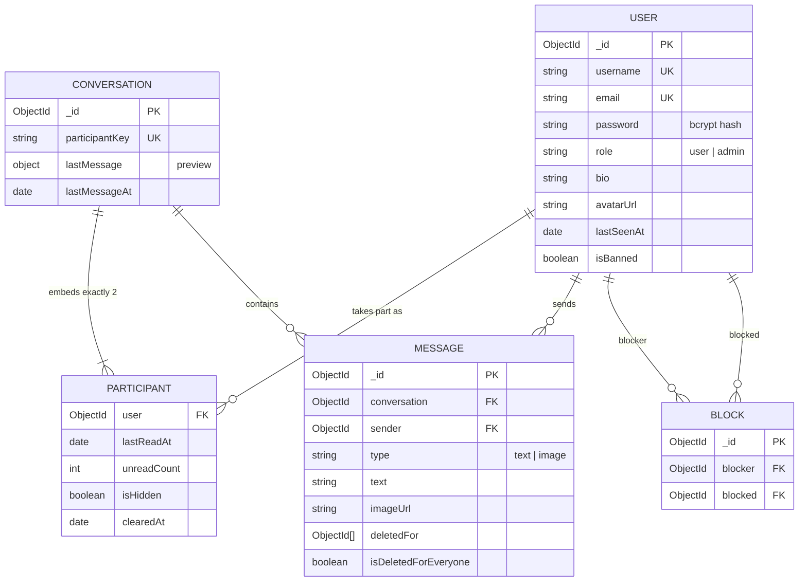

# ChatNest API

A WhatsApp/Instagram-style **direct messaging backend** built with Node.js, Express and MongoDB.
Users can register, find each other, chat one-to-one with **text and image messages**, see **read receipts and
unread counts**, **block** other users and **delete messages** for themselves or for everyone. Live updates
(new messages, read receipts, online status) are pushed over **Socket.IO**.

- 20 REST endpoints, documented with Swagger/OpenAPI at `/api-docs`
- JWT authentication, bcrypt password hashing, `user` and `admin` roles
- Joi request validation and a consistent JSON error format
- Image uploads with Multer: type and size checks, random file names, cleanup on delete
- Page-number pagination for lists and cursor pagination for message history
- 31 integration tests (Jest + Supertest + in-memory MongoDB)

---

## Tech stack

| Concern | Choice |
|---|---|
| Runtime / framework | Node.js 20+, Express 4 |
| Database | MongoDB with Mongoose 8 |
| Auth | jsonwebtoken (JWT), bcryptjs |
| Validation | Joi |
| File uploads | Multer (memory storage, written to local disk by a storage service) |
| Realtime push | Socket.IO 4 |
| Index migrations | migrate-mongo |
| Docs | swagger-jsdoc + swagger-ui-express |
| Logging / security | morgan, helmet, cors |
| Testing | Jest, Supertest, mongodb-memory-server |

---

## Architecture

Each request travels through these layers, and each layer has one job:

```
HTTP request
   │
   ▼
routes/        Which URL maps to which handler, and which middleware runs first
   │
middleware/    authenticate (JWT) → authorize (role) → upload (Multer) → validate (Joi)
   │
controllers/   Read the request, call one service function, send the response. No business logic.
   │
services/      Business rules: "can these two users chat?", "is the 15-minute window over?"
   │
models/        Mongoose schemas: data shape, defaults and indexes (the data access layer)
   │
MongoDB
```

Other building blocks:

- **`errorHandler`** turns every error into the same JSON shape and hides internal details behind a generic 500.
- **`socket/`** is a push-only realtime layer. Clients never write over the socket. Services call
  `emitToUser()` after a successful REST write, so all validation and business rules live in one place.
- **`storage.service`** is the only module that knows images are stored on local disk. Switching to Cloudinary or S3
  means changing only that file.

---

## Setup (Windows, macOS, Linux; no Docker needed)

### Prerequisites

- **Node.js 20+**
- **MongoDB**, either:
  - a local install ([MongoDB Community Server](https://www.mongodb.com/try/download/community)), running on `127.0.0.1:27017`, or
  - a free [MongoDB Atlas](https://www.mongodb.com/atlas) cluster: copy its connection string into `MONGODB_URI`

### Commands

```bash
# 1. Install dependencies
npm install

# 2. Configure the environment
cp .env.example .env          # PowerShell: Copy-Item .env.example .env
#    then edit .env: set MONGODB_URI and a long random JWT_SECRET
#    generate a secret with:
node -e "console.log(require('crypto').randomBytes(48).toString('hex'))"

# 3. Create the indexes (the MongoDB equivalent of migrations)
npm run migrate:up
npm run migrate:status

# 4. Run the API
npm run dev                   # auto-restart on file changes
npm start                     # production-style start

# 5. Run the tests (no database setup needed; uses an in-memory MongoDB)
npm test
```

> The first `npm test` downloads a MongoDB binary (~100 MB) for `mongodb-memory-server`. Later runs are fast.

Then open:

- API docs: <http://localhost:5000/api-docs>
- Health check: <http://localhost:5000/health>

### Sample accounts (already loaded in the development database; password for all: `Password123!`)

| Email | Username | Role | Notes |
|---|---|---|---|
| admin@chatnest.dev | admin | admin | Can list and ban users |
| aisha@example.com | aisha_k | user | Has chats with Rahul and Sara, one unread image message |
| rahul@example.com | rahul.v | user | Has chats with Aisha and Ken |
| sara@example.com | sara_l | user | Has blocked Priya |
| ken@example.com | ken_t | user | |
| priya@example.com | priya.n | user | Blocked by Sara |

### Environment variables

| Variable | Required | Default | Description |
|---|---|---|---|
| `MONGODB_URI` | ✅ | — | Connection string including the database name |
| `JWT_SECRET` | ✅ | — | Secret used to sign tokens |
| `JWT_EXPIRES_IN` | | `1d` | Token lifetime |
| `PORT` | | `5000` | HTTP and Socket.IO port |
| `NODE_ENV` | | `development` | `production` turns off auto-indexing (indexes come from migrations) |
| `UPLOAD_DIR` | | `uploads` | Where images are stored on disk |
| `CORS_ORIGIN` | | `*` | Allowed frontend origin for HTTP and Socket.IO |

---

## Entity relationship diagram



Full field list, indexes and design notes: [docs/er-diagram.md](docs/er-diagram.md).

---

## API endpoints

Base URL: `http://localhost:5000/api/v1`. 🔒 = needs `Authorization: Bearer <token>`.

> Building a frontend (or briefing an AI agent to build one)? Use **[docs/API_REFERENCE.md](docs/API_REFERENCE.md)**.
> It covers exact request and response shapes, TypeScript types, every error message, socket event handling and UI flows.

| Method | Path | Purpose | Auth |
|---|---|---|---|
| POST | `/auth/register` | Create an account | — |
| POST | `/auth/login` | Log in and get a JWT | — |
| GET | `/auth/me` | Current user | 🔒 |
| GET | `/users?search=&page=&limit=` | Search users (username prefix or name) | 🔒 |
| GET | `/users/:id` | Public profile, including `isOnline` and `lastSeenAt` | 🔒 |
| PATCH | `/users/me` | Update name and/or bio | 🔒 |
| PUT | `/users/me/avatar` | Upload a profile picture (`avatar` field, multipart) | 🔒 |
| GET | `/users/me/blocks` | Users I have blocked | 🔒 |
| POST | `/users/:id/block` | Block a user | 🔒 |
| DELETE | `/users/:id/block` | Unblock a user | 🔒 |
| POST | `/conversations` | Start a chat, or get the existing one (`201` new, `200` existing) | 🔒 |
| GET | `/conversations?unread=&page=&limit=` | My chats, newest activity first, with unread counts | 🔒 |
| GET | `/conversations/:id` | One conversation | 🔒 |
| PATCH | `/conversations/:id/read` | Mark as read (read receipts) | 🔒 |
| DELETE | `/conversations/:id` | Delete the chat for me only | 🔒 |
| GET | `/conversations/:id/messages?before=&limit=&type=&q=` | History (cursor pagination, type filter, keyword search) | 🔒 |
| POST | `/conversations/:id/messages` | Send text (JSON) or an image with an optional caption (multipart `image` + `text`) | 🔒 |
| DELETE | `/messages/:id?scope=me\|everyone` | Delete for me, or for everyone | 🔒 |
| GET | `/admin/users?isBanned=&search=&page=&limit=` | List all users | 🔒 admin |
| PATCH | `/admin/users/:id/ban` | Ban or unban `{ "isBanned": true }` | 🔒 admin |
| GET | `/health` | Health check (no `/api/v1` prefix) | — |
| GET | `/api-docs` | Swagger UI (no `/api/v1` prefix) | — |

### Response format

```jsonc
// Success
{ "success": true, "data": { ... }, "meta": { "page": 1, "limit": 20, "total": 42, "totalPages": 3 } }

// Message history uses a cursor instead of page numbers
{ "success": true, "data": [ ... ], "meta": { "limit": 30, "hasMore": true, "nextCursor": "6650f..." } }

// Error
{ "success": false, "error": { "status": 400, "message": "Validation failed",
  "details": [ { "location": "body", "field": "email", "message": "email must be a valid email" } ] } }
```

| Status | When |
|---|---|
| 200 / 201 / 204 | OK / created / deleted (no body) |
| 400 | Validation failed, invalid id, empty message, wrong file type |
| 401 | Missing, invalid or expired token; wrong login |
| 403 | Wrong role, banned, blocked, delete window passed |
| 404 | Not found, or not a participant (so chats can't be probed) |
| 409 | Duplicate email or username, already blocked, already deleted |
| 413 | Image larger than 5 MB |
| 500 | Unexpected error (details are logged, never sent to the client) |

### Business rules

- Text messages are 1–2,000 characters. Images must be JPG, PNG or WEBP, max 5 MB, one per message, with an optional caption.
- There is one conversation per pair of users, guaranteed by a unique `participantKey` index.
- You can't chat with yourself, a banned user, or anyone in a block relationship with you (in either direction).
- **Delete for everyone**: sender only, within 15 minutes. It clears the text and removes the image file from disk.
- **Delete for me**: hides the message only for you.
- **Delete chat**: hides the chat and clears its history for you only. It comes back if a new message arrives.
- **Read receipts**: your message shows `status: "read"` once the other person's `lastReadAt` is at or after it.
- A ban takes effect immediately: the user is checked on every request and their sockets are disconnected.

---

## Realtime events (Socket.IO)

Connect to the same host and port as the API, passing the JWT:

```js
import { io } from 'socket.io-client';

const socket = io('http://localhost:5000', { auth: { token: '<JWT>' } });

socket.on('message:new', (message) => { /* add to the open chat, bump the chat list */ });
socket.on('message:deleted', ({ conversationId, messageId }) => { /* show "This message was deleted" */ });
socket.on('conversation:read', ({ conversationId, readerId, readAt }) => { /* turn ticks blue */ });
socket.on('user:online', ({ userId }) => {});
socket.on('user:offline', ({ userId, lastSeenAt }) => {});
socket.on('connect_error', (err) => console.log(err.message)); // e.g. "Invalid or expired token"
```

| Event | Sent to | When |
|---|---|---|
| `message:new` | recipient | A message is sent |
| `message:deleted` | the other participant | A message is deleted for everyone |
| `conversation:read` | the other participant | `PATCH /conversations/:id/read` |
| `user:online` | users who share a chat with you | Your first socket connects |
| `user:offline` | users who share a chat with you | Your last socket disconnects (also updates `lastSeenAt`) |

---

## Sample requests

These use `curl` in **Git Bash**, macOS or Linux. In Windows PowerShell, type `curl.exe` instead of `curl` and put each command on one line.

```bash
BASE=http://localhost:5000/api/v1

# Register
curl -X POST $BASE/auth/register -H "Content-Type: application/json" \
  -d '{"name":"Jay","username":"jay_dev","email":"jay@example.com","password":"Password123!"}'

# Log in as two sample users and keep their tokens
AISHA=$(curl -s -X POST $BASE/auth/login -H "Content-Type: application/json" \
  -d '{"email":"aisha@example.com","password":"Password123!"}' | node -pe "JSON.parse(require('fs').readFileSync(0)).data.token")
KEN=$(curl -s -X POST $BASE/auth/login -H "Content-Type: application/json" \
  -d '{"email":"ken@example.com","password":"Password123!"}' | node -pe "JSON.parse(require('fs').readFileSync(0)).data.token")

# Aisha searches for Ken
curl "$BASE/users?search=ken" -H "Authorization: Bearer $AISHA"

# Start a conversation (use Ken's _id from the search result)
curl -X POST $BASE/conversations -H "Authorization: Bearer $AISHA" -H "Content-Type: application/json" \
  -d '{"participantId":"<KEN_ID>"}'

# Send a text message
curl -X POST $BASE/conversations/<CONVERSATION_ID>/messages -H "Authorization: Bearer $AISHA" \
  -H "Content-Type: application/json" -d '{"text":"Hi Ken! 👋"}'

# Send an image with a caption
curl -X POST $BASE/conversations/<CONVERSATION_ID>/messages -H "Authorization: Bearer $AISHA" \
  -F "image=@./photo.jpg" -F "text=Look at this view"

# Ken lists unread chats, reads the history and marks the chat as read
curl "$BASE/conversations?unread=true" -H "Authorization: Bearer $KEN"
curl "$BASE/conversations/<CONVERSATION_ID>/messages?limit=20" -H "Authorization: Bearer $KEN"
curl -X PATCH $BASE/conversations/<CONVERSATION_ID>/read -H "Authorization: Bearer $KEN"

# Load older messages, search, or show only images
curl "$BASE/conversations/<CONVERSATION_ID>/messages?before=<nextCursor>" -H "Authorization: Bearer $KEN"
curl "$BASE/conversations/<CONVERSATION_ID>/messages?q=view&type=image" -H "Authorization: Bearer $KEN"

# Delete a message for everyone (sender, within 15 min) or just for me
curl -X DELETE "$BASE/messages/<MESSAGE_ID>?scope=everyone" -H "Authorization: Bearer $AISHA"
curl -X DELETE "$BASE/messages/<MESSAGE_ID>?scope=me" -H "Authorization: Bearer $KEN"

# Block and unblock
curl -X POST $BASE/users/<USER_ID>/block -H "Authorization: Bearer $KEN"
curl -X DELETE $BASE/users/<USER_ID>/block -H "Authorization: Bearer $KEN"

# Upload an avatar
curl -X PUT $BASE/users/me/avatar -H "Authorization: Bearer $AISHA" -F "avatar=@./me.png"

# Admin: list banned users, ban someone
ADMIN=$(curl -s -X POST $BASE/auth/login -H "Content-Type: application/json" \
  -d '{"email":"admin@chatnest.dev","password":"Password123!"}' | node -pe "JSON.parse(require('fs').readFileSync(0)).data.token")
curl "$BASE/admin/users?isBanned=false" -H "Authorization: Bearer $ADMIN"
curl -X PATCH $BASE/admin/users/<USER_ID>/ban -H "Authorization: Bearer $ADMIN" \
  -H "Content-Type: application/json" -d '{"isBanned":true}'
```

The easiest way to try everything is **Swagger UI** at `/api-docs`: log in, click **Authorize** and paste the token.

---

## Testing

```bash
npm test
```

- `tests/auth.test.js` covers registration, duplicate and invalid input, login (including identical errors for a wrong
  password and an unknown email), banned users, invalid tokens, and admin vs. user access.
- `tests/messaging.test.js` covers the core workflow: start or reuse a chat, block rules, send text and images, file type
  checks, unread counts, read receipts, cursor pagination, search, delete for me, and delete for everyone (including the
  15-minute window and image file cleanup).

Tests run against `mongodb-memory-server`, a temporary MongoDB started by Jest, so they never touch your real data.

---

## Project structure

```
realtime-chat/
├── src/
│   ├── config/          env loading and validation, DB connection, constants, Swagger spec
│   ├── models/          Mongoose schemas: User, Conversation (+ embedded Participant), Message, Block
│   ├── services/        business logic: auth, user, block, conversation, message, admin, storage
│   ├── controllers/     thin request/response handlers
│   ├── routes/          Express routers + OpenAPI annotations
│   ├── middleware/      auth, role check, Joi validation, Multer upload, 404, error handler
│   ├── validators/      Joi schemas per resource
│   ├── socket/          Socket.IO setup, JWT handshake, presence, emit helpers
│   ├── utils/           ApiError, asyncHandler, pagination, response helpers, JWT helpers
│   ├── app.js           Express app (no network; imported by tests)
│   └── server.js        connects to DB, attaches Socket.IO, starts listening
├── migrations/          migrate-mongo index migrations
├── tests/               Jest + Supertest integration tests
├── docs/                ER diagram and data model notes, resume kit
├── .env.example
├── jest.config.js
├── migrate-mongo-config.js
└── package.json
```

---

## Design decisions

- **REST for writes, Socket.IO only for pushes.** All validation and business rules live in one place, and everything can be tested over plain HTTP.
- **Participants are embedded in the conversation.** A direct chat always has two participants that are always read together, so there's no extra lookup.
- **`unreadCount` is a stored counter.** The chat list is one query, instead of counting messages for every conversation.
- **Cursor pagination for messages.** New messages arriving while you scroll don't cause duplicates or gaps, unlike `skip`.
- **Multer memory storage with an explicit save.** Files reach disk only after the request passes validation, so failed requests leave no orphan files.
- **404 for chats you aren't in.** Other users can't tell whether a conversation id exists.

## Known limitations

- Online presence is kept in memory, so it is accurate for a **single server instance**.
- Images are stored on local disk. Many hosting platforms erase local disk on redeploy, so use cloud storage in production.
- File type is checked by the upload's declared MIME type, not by inspecting the file contents.
