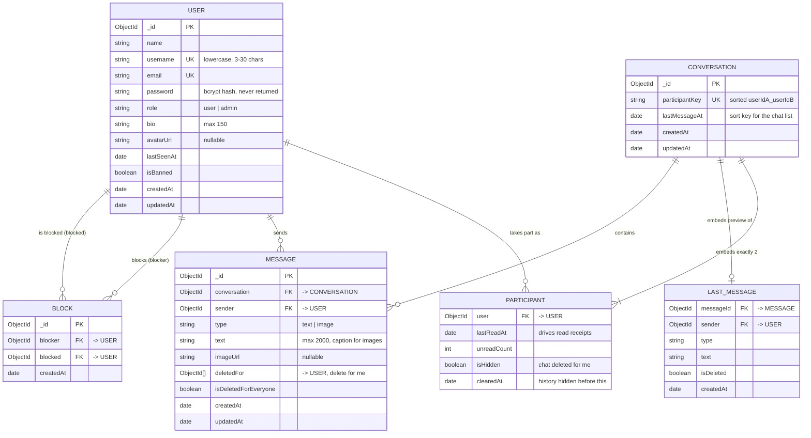

# ChatNest: Data Model

MongoDB stores four collections. `Participant` and `LastMessage` are **embedded sub-documents** inside
`Conversation`, not separate collections, because a direct chat always has exactly two participants that are
always read together with the conversation.

## Indexes (created by `migrations/20261109000000-create-indexes.js`)

| Collection | Index | Why |
|---|---|---|
| users | `{ username: 1 }` unique | No duplicate usernames; fast prefix search |
| users | `{ email: 1 }` unique | No duplicate accounts; fast login lookup |
| conversations | `{ participantKey: 1 }` unique | Only one chat per pair of users, even under concurrent requests |
| conversations | `{ 'participants.user': 1, lastMessageAt: -1 }` | "My chats, newest first" |
| messages | `{ conversation: 1, _id: -1 }` | Message history and cursor pagination |
| blocks | `{ blocker: 1, blocked: 1 }` unique | A user can block someone only once; fast block checks |

## How relationships are enforced without foreign keys

- **References** use `ObjectId` fields with Mongoose `ref`, so `.populate()` can join them.
- **Existence and ownership checks** happen in the service layer (for example, "is this user a participant of this
  conversation?") before any write.
- **Uniqueness** is enforced by unique indexes, which are safe under concurrent requests.
- **No cascading deletes** are needed: users are banned, never hard-deleted, so references never point to missing documents.
